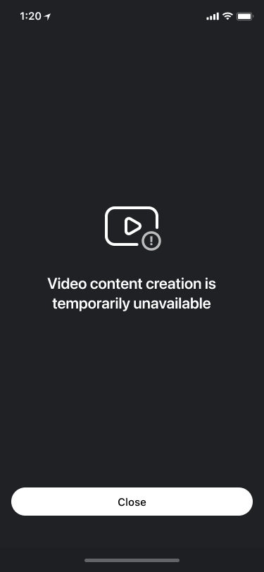

# Quickstart Guide

- [Installation](#Installation)
- [Info.plist Updates](#Info.plist-Updates)
- [Video Editor SDK Setup](#Video-Editor-SDK-Setup)
- [Launch](#Launch)
- [Implement export](#Implement-export)
- [Customization options](#Customization-options)

## Installation

### CocoaPods
:exclamation: Important
Requires CocoaPods 1.12.1+. Check with pod --version and upgrade if needed.

1. Add sources and pods to your Podfile:

```ruby
source 'https://cdn.cocoapods.org/'
source 'https://github.com/Banuba/specs.git'
source 'https://github.com/sdk-banuba/banuba-sdk-podspecs.git'

banuba_sdk_version = '1.55.0'

pod 'BanubaVideoEditorSDK', banuba_sdk_version
pod 'BanubaSDKSimple', banuba_sdk_version
pod 'BanubaSDK', banuba_sdk_version
pod 'BanubaARCloudSDK', banuba_sdk_version      # optional
pod 'BanubaAudioBrowserSDK', banuba_sdk_version # optional
```
2. Install the pods:

```sh
pod install --repo-update
```

3. Open the generated ```.xcworkspace``` in Xcode and run the project.

### SPM

SPM integration is available in the [spm branch](https://github.com/Banuba/ve-sdk-ios-integration-sample/tree/spm).

1. Add the required packages using the URLs:
https://github.com/Banuba/BanubaVideoEditorSDK-iOS
https://github.com/Banuba/BanubaSDK-iOS

2. Use Exact Version mode and specify the 1.50.1 version.

:exclamation: Info
For more details, refer to the [SPM Mandatory modules](https://docs.banuba.com/ve-pe-sdk/docs/ios/mandatory-modules).

## Info.plist Updates

The ```Video Editor SDK``` uses the camera and microphone to record video, and the photo library to select media. Local music requests access to the user's media library. Add the corresponding usage descriptions to your [Info.plist](../Example/Example/Info.plist); iOS shows these strings when asking for permission. Adjust the wording to describe how your app uses each resource:

```xml
<key>NSAppleMusicUsageDescription</key>
<string>This app requires access to the media library.</string>
<key>NSCameraUsageDescription</key>
<string>This app requires access to the camera.</string>
<key>NSMicrophoneUsageDescription</key>
<string>This app requires access to the microphone.</string>
<key>NSPhotoLibraryUsageDescription</key>
<string>This app requires access to the photo library.</string>
```

## Video Editor SDK Setup

Configure and initialize `VideoEditorSDK` directly in [ExampleViewController](../Example/Example/ExampleViewController.swift):

```swift
var featureConfiguration = VideoEditorConfig().featureConfiguration
featureConfiguration.supportsTrimRecordedVideo = true

let editorSDK = VideoEditorSDK.Builder()
    .setEditorV2Enabled(isEditorV2Enabled)
    .setAudioBrowserProvider(.local)
    .setFeatureConfiguration(featureConfiguration)
    .initialize(token: AppDelegate.licenseToken) 

// The SDK holds its delegate weakly. Store the handler in self.editorHandler;
// otherwise it is deallocated when this method returns and receives no callbacks.
let handler = VideoEditorHandler(self)

self.editorSDK = editorSDK
self.editorHandler = handler
editorSDK.delegate = handler
```

:exclamation: Important
```editorSDk``` is ```nil``` if the license token is invalid – verify your token.

## Launch

1. [Check license activation](../Example/Example/ExampleViewController.swift#L219) before starting the editor.
2. Expired/revoked licenses show a "Video content unavailable" screen
<p align="center">

</p>

```swift
let cameraLaunchConfig = VideoEditorLaunchConfig(
    entryPoint: .camera,
    hostController: self,
    animated: true
)

editorSDK.launch(with: cameraLaunchConfig)
```

## Implement export

`VideoEditorSDK` exports the video and reports the result through `VideoEditorSDKDelegate`. Implement the callbacks in `VideoEditorHandler`:

- `videoEditorClose()`: release the SDK when the editor closes.
- `videoEditorExportDone(with:error:coverImages:)`: log the error if export failed; otherwise take the first URL from `videoUrls` and pass it to `showExportResult(videoUrl:)`.

See the handler in [ExampleViewController.swift](../Example/Example/ExampleViewController.swift).

Read the [Export integration guide](https://docs.banuba.com/ve-pe-sdk/docs/ios/guide_export) for more details.

## Customization options

Configure video features with `VideoEditorSDK.Builder` before `initialize(token:)`, and photo features with `PhotoEditorConfig`. Explore more [customization options](https://docs.banuba.com/ve-pe-sdk/docs/ios/adv-integration-overview/) in our documentation.
